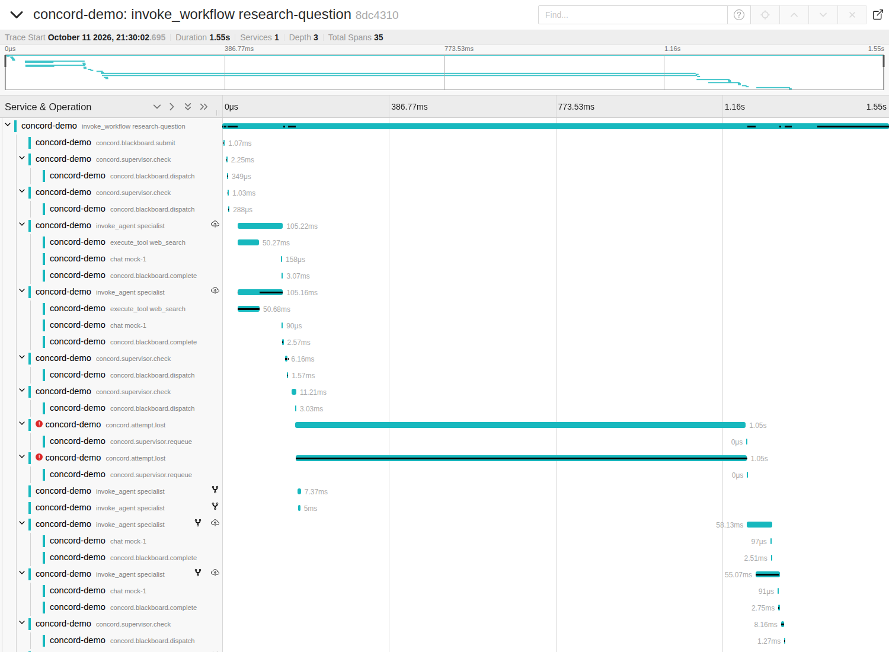

# Tracing

One run is one OpenTelemetry trace. The trace context travels through the blackboard as
W3C `traceparent` strings, so spans from different workers and from the supervisor join
the same trace.

## What a trace looks like



This is `examples/trace_dead_worker.py`: five subgoals, two workers, and both workers are
killed while they hold the two summary subgoals. Reading the screenshot top to bottom:

1. **`invoke_workflow research-question`** is the root span for the whole run (1.55s).
2. **`concord.supervisor.check`** spans are the pre-dispatch checks. Each has a
   `concord.blackboard.dispatch` child, the write that put the subgoal in the worker queue.
3. **`invoke_agent specialist`** spans are attempts. The first two are the searches, each
   with an `execute_tool web_search` call, a `chat mock-1` model call and the
   `concord.blackboard.complete` write nested inside.
4. **`concord.attempt.lost`** (red, about 1.05s each) are the failed attempts. A dead
   worker can never end its own span, so the supervisor writes this span on its behalf,
   covering the time the lease was held. Its child, `concord.supervisor.requeue`, marks
   the moment the supervisor put the subgoal back in the queue.
5. The **`invoke_agent specialist`** spans starting at about 1.16s are the retries by the
   surviving workers, followed by the check and attempt for the final answer.

The two very short `invoke_agent` spans just after the lost attempts start are an artifact
of the example: it simulates a crash by cancelling the worker task, which still lets the
span close. A worker process that really dies leaves no span of its own, which is exactly
why `concord.attempt.lost` exists.

## How the trace follows the subgoal graph

Every attempt is a direct child of the run's root span, and carries a **span link** to the
span that finished each of its dependencies. The small fork icons in the screenshot are
those links. A duplicate that the supervisor served from an earlier result links to the
span that produced that result.

Attempts are deliberately not nested under their dependencies. A dependency's span has
already ended by the time the dependent starts, and trace viewers treat a child that
starts after its parent ended as clock skew: Jaeger shifted those spans by up to 86ms and
attached warnings when an earlier version of this code nested them.

## Span reference

| Span | Kind | Key attributes |
|------|------|----------------|
| `invoke_workflow {name}` | internal | `gen_ai.operation.name`, `gen_ai.workflow.name`, `concord.run.id` |
| `invoke_agent {agent}` | internal | `gen_ai.operation.name`, `gen_ai.agent.name`, `concord.subgoal.id`, `concord.subgoal.attempt`, `concord.worker.id`, `concord.usage.total_tokens`, `error.type` |
| `chat {model}` | client | `gen_ai.operation.name`, `gen_ai.provider.name`, `gen_ai.request.model`, `gen_ai.usage.input_tokens`, `gen_ai.usage.output_tokens` |
| `execute_tool {tool}` | internal | `gen_ai.operation.name`, `gen_ai.tool.name`, `error.type` |
| `concord.supervisor.check` | internal | `concord.check.outcome` (`dispatch`, `reuse` or `hold`), `concord.check.duplicate_of`, `concord.reason` |
| `concord.supervisor.release` | internal | same as `check`; emitted when a held duplicate is resolved |
| `concord.attempt.lost` | internal | `concord.subgoal.attempt`, `concord.worker.id`, `error.type` = `lease_expired` |
| `concord.supervisor.requeue` / `.fail` | internal | `concord.reason` |
| `concord.supervisor.halt` | internal | `concord.reason` |
| `concord.blackboard.{submit,dispatch,complete,fail,reuse,hold,halt}` | internal | `db.system.name` = `redis`, `concord.subgoal.id` |

The `gen_ai.*` names follow the OpenTelemetry GenAI semantic conventions. Those are still
in Development status with no tagged release, so the code is written against
[commit 6fd0d763a0](https://github.com/open-telemetry/semantic-conventions-genai/tree/6fd0d763a0)
of the conventions repository (2026-10-09) and may need renames when they stabilize.

Prompts and model outputs are never put on spans.

## Using it

```python
from concord.tracing import TracedModelClient, configure, tool_span, workflow_span

configure()  # OTLP/HTTP to localhost:4318; or install your own tracer provider

model = TracedModelClient(real_client, model="...", provider="...")

with workflow_span("research-question", board.run_id):
    await board.submit(graph, supervised=True)
    await asyncio.gather(pool.run(), Supervisor(board).run())
```

Open the root span around both `submit` and the code that waits for the run. Inside a
handler, wrap tool calls in `with tool_span("web_search"):`.

Without `configure()` (or another SDK setup) every span is a no-op, and the library only
depends on the OpenTelemetry API at that point.

To see a trace locally:

```sh
docker compose up -d redis jaeger
uv run python examples/trace_dead_worker.py   # prints a link to the trace
```

## Limits

- Polling operations (lease attempts, heartbeats, the supervisor's periodic reclaim) are
  not traced; they would bury the trace in empty spans.
- If the caller opens no root span, attempts hang off the short `concord.blackboard.submit`
  span and Jaeger will report clock-skew adjustments. Open a `workflow_span`.
- No tools exist yet, so `execute_tool` spans only appear in the example and tests.
